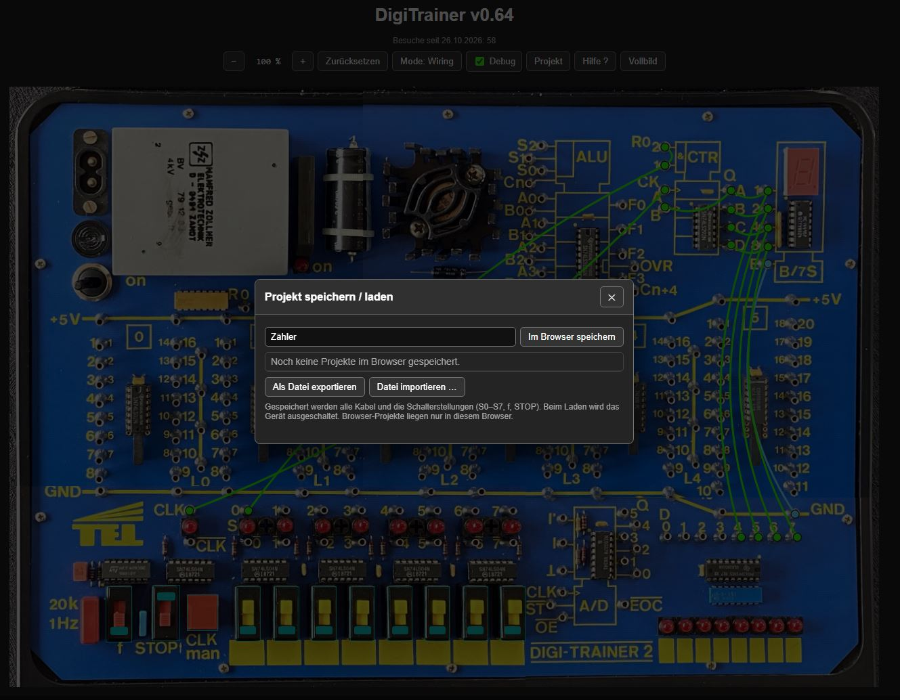

# DigiTrainer

**A web-based simulator of the ITT Digi-Trainer 2 digital electronics training system.**

<a href="https://manibecker.github.io/DigiTrainer/">
  
</a>

Der **DigiTrainer** ist ein browserbasierter Simulator des historischen **ITT Digi-Trainer 2**, eines Lehr- und Experimentiersystems für digitale Elektronik.

Ziel des Projekts ist es, die Funktionen und Experimente des Originals möglichst realitätsnah am Bildschirm nachzubilden. Dazu gehören Schalter, LEDs, Steckbuchsen, Patchkabel und verschiedene digitale Logikbausteine.

Der Simulator basiert auf Fotografien eines originalen ITT Digi-Trainer 2. Die Bedienelemente und Steckbuchsen wurden durch interaktive Elemente ergänzt. Die gesteckten Verbindungen werden elektrisch ausgewertet, sodass sich digitale Schaltungen aufbauen und unmittelbar ausprobieren lassen.

**Keine Installation, keine zusätzliche Hardware – ein moderner Browser genügt.**

## 🚀 Live-Demo

Der aktuelle Entwicklungsstand kann direkt im Browser ausprobiert werden:

👉 **[DigiTrainer starten](https://manibecker.github.io/DigiTrainer/)**

<a href="https://manibecker.github.io/DigiTrainer/">
  
</a>

## ✨ Bereits implementierte Funktionen

### Bedienung und Verdrahtung

- Originalgetreue Darstellung des ITT Digi-Trainer 2
- Interaktiver Hauptschalter mit Betriebsanzeige
- Acht bedienbare Schiebeschalter S0–S7
- Simulation der Schalter- und Ausgangs-LEDs D0–D7
- Mehr als 200 definierte Steckbuchsen (Hotspots)
- Patchkabel durch Ziehen zwischen zwei Buchsen stecken
- Einzelne Patchkabel durch erneutes Ziehen derselben Verbindung entfernen
- Die Steckrichtung ist dabei unerheblich: A → B entspricht B → A
- Grafische Darstellung der Kabel mit leichtem Durchhang
- Elektrische Auswertung der gesteckten Verbindungen
- Gemeinsame +5-V- und GND-Versorgungsschienen
- Fünf passive Verbindungsschienen L0–L4 mit jeweils vier elektrisch verbundenen Buchsen
- Erkennung von Kurzschlüssen und Ausgangskonflikten
- Anzeige von Anschlussbezeichnungen und IC-Pinfunktionen

Die Verdrahtung und das Entfernen von Patchkabeln erfolgen bei ausgeschaltetem DigiTrainer. Nach dem Einschalten können die Schalter betätigt und die logischen Zustände beobachtet werden.

### Digitale Logikbausteine

Die sechs Logik-IC-Sockel des DigiTrainers sind bereits implementiert:

| Sockel | IC | Funktion |
|---|---|---|
| 0 | SN74LS02N | 4 × NOR mit je 2 Eingängen |
| 1 | SN74LS04N | 6 × NOT (Inverter) |
| 2 | SN74LS08N | 4 × AND mit je 2 Eingängen |
| 3 | SN74LS86AN | 4 × XOR mit je 2 Eingängen |
| 4 | 74LS00PC | 4 × NAND mit je 2 Eingängen |
| 5 | CD4069UBE | 6 × CMOS-NOT (Inverter) |

Die Logikgatter können über Patchkabel miteinander kombiniert werden. Ihre Ausgangszustände werden anhand der Eingangssignale berechnet.

Die ICs benötigen eine korrekte Verbindung zu +5 V und GND. Nicht angeschlossene Eingänge können einen unbestimmten Zustand annehmen.

### Taktgenerator

Der integrierte Taktgenerator ist ebenfalls simuliert.

- Automatischer Takt mit 1 Hz oder 10 Hz
- Manueller Takt über einen Taster
- Starten und Anhalten des automatischen Takts
- Takt- und invertierter Taktausgang

Damit lassen sich auch zeitabhängige digitale Schaltungen untersuchen.

### 4-Bit-Binärzähler – SN74LS293N

Der **SN74LS293N** ist als digitaler 4-Bit-Zähler implementiert.

- Zwei Takteingänge CK A und CK B
- Vier Ausgänge QA–QD
- Zwei asynchrone Reset-Eingänge
- Binäre Zählfolge von 0 bis 15
- Anschluss an den integrierten Taktgenerator

In Verbindung mit der 7-Segment-Anzeige lassen sich die Zählerstände unmittelbar sichtbar machen.

### 7-Segment-Anzeige – MC14495P

Die integrierte 7-Segment-Anzeige wird durch einen **MC14495P** angesteuert.

- Vier binäre Eingänge mit den Wertigkeiten 1, 2, 4 und 8
- Darstellung der Hexadezimalwerte 0 bis F
- Latch-Funktion über den Eingang E
- Anzeige reagiert auf die elektrisch verbundenen Eingangssignale

Damit können beispielsweise die Ausgänge des Binärzählers oder der ALU direkt angezeigt werden.

### 4-Bit-ALU – SN74LS382N

Auch die **Arithmetic Logic Unit (ALU)** des DigiTrainers ist inzwischen implementiert.

Die ALU verarbeitet zwei 4-Bit-Zahlen und stellt das Ergebnis an vier Ausgängen bereit.

| Anschlüsse | Funktion |
|---|---|
| A0–A3 | Erster 4-Bit-Operand |
| B0–B3 | Zweiter 4-Bit-Operand |
| S0–S2 | Auswahl der Operation |
| Cn | Eingangsübertrag |
| F0–F3 | 4-Bit-Ergebnis |
| OVR | Überlaufsignal |
| Cn+4 | Ausgangsübertrag |

Unterstützt werden arithmetische und logische Operationen, darunter Addition, Subtraktion, AND, OR und XOR.

**Erster erfolgreicher Test: 3 + 2 = 5**

Das Ergebnis wurde über Patchkabel an die 7-Segment-Anzeige übertragen und dort korrekt dargestellt.

### 6-Bit-A/D-Wandler – NE5037N (experimentell)

Der integrierte **NE5037N** ist inzwischen als vereinfachtes Modell eines 6-Bit-Analog-Digital-Wandlers implementiert.

- Berücksichtigung des analogen Eingangssignals im vereinfachten Simulationsmodell
- Sechs digitale Ausgänge Q0–Q5
- Start-, Takt- und Freigabesignale
- Wandlungsablauf über mehrere Taktzyklen
- Darstellung des Wandlungsergebnisses über die Ausgangs-LEDs

**Erfolgreich getestete Grenzwerte:**

- 0 V am Eingang → `000000`
- +5 V am Eingang → `111111`

Die Modellierung ist noch **experimentell**. Insbesondere die tatsächliche analoge Beschaltung des Originalgeräts, Zwischenwerte und zeitliche Details müssen weiter untersucht und verifiziert werden.

## 💾 Projekte speichern und laden

Ab **v0.64** lassen sich aufgebaute Schaltungen über den Button **Projekt** speichern und später wiederherstellen.

- **Im Browser speichern:** Projekte unter einem frei wählbaren Namen im lokalen Browserspeicher (`localStorage`) ablegen, aus einer Liste laden oder löschen.
- **Als Datei exportieren:** Die aktuelle Schaltung als lesbare **JSON-Datei** herunterladen.
- **Datei importieren:** Eine zuvor exportierte JSON-Datei auswählen und die Schaltung wiederherstellen – auch auf einem anderen Rechner oder in einem anderen Browser.

Gespeichert werden die Verbindungen zwischen den Steckbuchsen, die Stellungen der Schalter **S0–S7**, die Einstellungen **f** und **STOP** des Taktgenerators sowie die **Debug-Anzeige**. Die Dateien enthalten Buchsen-IDs und Schalterzustände, keine Bildschirmfotos.

Beim Laden wird der DigiTrainer ausgeschaltet. Interne Laufzeitzustände der simulierten Bausteine, etwa ein aktueller Zählerstand, werden nicht gespeichert. Im Browser abgelegte Projekte sind an den jeweiligen Browser und die Website gebunden und können beim Löschen der Browserdaten verloren gehen. Für eine dauerhafte Sicherung empfiehlt sich der JSON-Export.

Die Projektverwaltung wurde von **[Lutz (lschulze)](https://github.com/lschulze)** als erster externer Beitrag über **[Pull Request #1](https://github.com/ManiBecker/DigiTrainer/pull/1)** beigesteuert.

## 🐞 Debug-Anzeige

Über die Checkbox **Debug** lassen sich bei eingeschaltetem Gerät die logischen Zustände der Verdrahtung farblich anzeigen: **Rot** für HIGH (1), **Hellblau** für LOW (0) und **Hellgrau** für einen unbestimmten Zustand. Zusätzlich erscheinen die binären Zustände **0/1** unter den Schaltern S0–S7 und den Ausgangs-LEDs D0–D7.

Ohne Debug-Anzeige bleiben die üblichen Kabelfarben für Versorgung und Verdrahtung erhalten.

## 🔍 Zoom und Vollbild

- Zoom von 100 % bis 400 %
- Zoom über Schaltflächen und Tastatur
- Mausrad-Zoom am PC
- Zwei-Finger-Zoom auf Touchscreens
- Verschieben der vergrößerten Platine
- Automatische Anpassung an die Bildschirmgröße
- Vollbildmodus auf PC und iPad
- Pseudo-Vollbildmodus auf dem iPhone

Der Simulator ist damit auch auf Smartphones und Tablets bedienbar.

## 📐 Vermessungsmodus

Mit der Taste **M** kann zwischen Verdrahtungs- und Vermessungsmodus umgeschaltet werden.

Im Vermessungsmodus lassen sich Positionen und rechteckige Bereiche auf der Platine bestimmen. Die Koordinaten werden im JSON-Format ausgegeben und erleichtern die Definition weiterer Hotspots.

## 🎮 Bedienung

| Aktion | Funktion |
|---|---|
| Hauptschalter | DigiTrainer ein- oder ausschalten |
| Ziehen von Buchse A zu Buchse B | Patchkabel stecken |
| Erneutes Ziehen zwischen denselben Buchsen | Vorhandenes Patchkabel entfernen (auch B → A) |
| Schiebeschalter anklicken | Logischen Zustand ändern |
| Taktgenerator bedienen | Manuellen oder automatischen Takt erzeugen |
| M | Vermessungsmodus umschalten |
| + / − | Vergrößern / Verkleinern |
| 0 | Zoom auf 100 % zurücksetzen |
| Mausrad | Zoom am Mauszeiger |
| Zwei-Finger-Geste | Zoom auf Touchscreens |
| Vollbild | Vollbildmodus aktivieren oder beenden |
| Debug | Logikpegel und binäre Zustände ein- oder ausblenden |
| Projekt | Schaltung im Browser speichern/laden oder als JSON-Datei exportieren/importieren |

**Hinweis:** Patchkabel lassen sich nur bei ausgeschaltetem DigiTrainer stecken oder entfernen.

## 🛠 Technische Umsetzung

Der DigiTrainer wird vollständig mit **HTML, CSS und JavaScript** umgesetzt und benötigt keine Installation.

Die wichtigsten Projektdateien sind:

```text
DigiTrainer/
├── index.html
├── help.html
├── css/
│   └── digitrainer.css
├── js/
│   ├── simulator.js
│   └── projekt.js
├── boards/
│   └── itt-digitrainer2/
│       ├── board.jpg
│       └── board.json
└── images/
    ├── digitrainer-v0.61.jpg
    └── digitrainer-qr.jpg
```

Die Aufgaben der einzelnen Dateien:

- `index.html` – Benutzeroberfläche
- `css/digitrainer.css` – Darstellung und Layout
- `js/simulator.js` – Bedienung, Verdrahtung und elektrische Simulation
- `js/projekt.js` – Projektverwaltung, Browserspeicher sowie JSON-Import und -Export
- `help.html` – Bedienungshinweise und Hilfe
- `boards/itt-digitrainer2/board.jpg` – Foto des Originalgeräts
- `boards/itt-digitrainer2/board.json` – Positionen und Definitionen der Steckbuchsen, Schalter und LEDs

Die Simulation arbeitet mit einem Verbindungsmodell, das die über Patchkabel zusammengeschalteten Anschlüsse zu elektrischen Netzen zusammenfasst. Dazu gehören auch die passiven Verbindungsschienen L0–L4.

Auf dieser Grundlage werden die Eingangssignale, Logikfunktionen und Ausgangszustände berechnet. Bei Änderungen der Verdrahtung wird die Netzstruktur neu ausgewertet.

Der Schwerpunkt liegt derzeit auf dem logischen Verhalten der Schaltungen. Analoge Eigenschaften wie reale Signallaufzeiten, Stromaufnahme oder elektrische Belastbarkeit werden nicht vollständig nachgebildet.

Das Projekt wird über **GitHub Pages** bereitgestellt.

## 📋 Geplante Erweiterungen

- Untersuchung und Simulation des Widerstandsnetzwerks R0–R7
- Verfeinerung und Validierung des analogen Modells des NE5037N
- Farbliche Kennzeichnung der logischen Pegel (HIGH/LOW/undefiniert) an den Steckbuchsen
- Optionaler virtueller Signalprüfer oder digitales Oszilloskop
- Experimente aus dem originalen ITT-Lehrmaterial nachbilden
- Weitere Verbesserungen der elektrischen Simulation
- Ergänzung von Beispielschaltungen und Bedienungshinweisen

## 📌 Projektstatus

**Work in Progress – Version 0.64, Oktober 2026**

Die grundlegende Bedienung, Verdrahtung und Simulation der sechs Logik-ICs sind implementiert. Darüber hinaus wurden folgende Funktionen bereits in grundlegenden Funktionstests erprobt:

- Taktgenerator
- 4-Bit-Binärzähler SN74LS293N
- 7-Segment-Anzeige mit MC14495P
- 4-Bit-ALU SN74LS382N (unter anderem Test `3 + 2 = 5`)
- Experimenteller 6-Bit-A/D-Wandler NE5037N (Grenzwerte 0 V und +5 V)
- Passive Verbindungsschienen L0–L4
- Gezieltes Entfernen einzelner Patchkabel durch erneutes Ziehen der Verbindung
- Debug-Anzeige mit Logikpegeln und binären Zustandsanzeigen
- Speichern und Laden mehrerer Projekte im Browser
- Export und Import von Schaltungen als JSON-Dateien

Die wesentlichen digitalen Funktionsgruppen des Originalgeräts sind damit im Simulator abgebildet. Einige Details – insbesondere die analoge Beschaltung, das Widerstandsnetzwerk und das Verhalten bei Grenzfällen – müssen noch weiter untersucht werden.

Der DigiTrainer ist ein privates Hobby- und Lernprojekt. Die Simulation wird schrittweise erweitert und erhebt noch keinen Anspruch auf vollständige elektrische Genauigkeit.

**Fehlermeldungen, Anregungen und Verbesserungsvorschläge sind herzlich willkommen!**

## 🙏 Danksagung

Ein besonderer Dank gilt **jobi23 aus dem Classic-Computing-Forum**, der Fotografien seines originalen ITT Digi-Trainer 2 für dieses Projekt zur Verfügung gestellt hat.

Ohne diese Bilder wäre die originalgetreue Darstellung des Geräts in dieser Form nicht möglich gewesen.

Vielen Dank auch an die Mitglieder des Classic-Computing-Forums für die Anregungen und Diskussionen rund um dieses Projekt.

Ein herzliches Dankeschön an **[Lutz (lschulze)](https://github.com/lschulze)** für die Entwicklung der Projektverwaltung mit Browserspeicher und JSON-Import/-Export – den ersten externen Pull Request für den DigiTrainer. Lutz hat dabei auch KI-Unterstützung durch Grok genutzt.

## 🔗 Links

- **Live-Demo:** https://manibecker.github.io/DigiTrainer/
- **GitHub-Repository:** https://github.com/ManiBecker/DigiTrainer
- **Classic-Computing-Forum:** https://forum.classic-computing.de/
