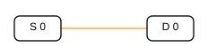
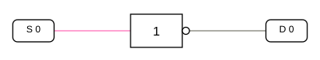

// DigiTrainer – Experiment 01
// Ablage: docs/experiment01-not-gatter.adoc
// Zugehörige Grafiken: docs/projects/experiment01a-schalter-led.svg
//                     docs/projects/experiment01b-not-gatter.svg
// Zugehörige Projekte: projects/experiment01a-schalter-led.json
//                      projects/experiment01b-not-gatter.json

== Experiment 1 – Schalter, LED und NOT-Gatter

In unserem ersten Experiment lernen wir zwei Grundbausteine digitaler Schaltungen kennen: einen Schalter als Eingang und eine Leuchtdiode (LED) als Ausgang. Anschließend schalten wir ein NOT-Gatter dazwischen und beobachten, wie sich das Verhalten verändert.

=== Lernziele

Nach diesem Experiment kannst du:

* die logischen Zustände `0` (LOW) und `1` (HIGH) unterscheiden,
* den Zustand eines Schalters mit einer LED sichtbar machen,
* die Funktion eines NOT-Gatters erklären,
* ein Gatter des 74LS04 auf dem DigiTrainer verdrahten und
* die zugehörige Wahrheitstabelle lesen.

=== Vorbereitung

Öffne den DigiTrainer im Browser. Zum Verdrahten muss der Hauptschalter zunächst auf *OFF* stehen. Schalte erst nach dem Verbinden der Buchsen auf *ON*, um die Schaltung zu testen.

Für die folgenden Versuche verwenden wir den Schalter *S0* und die LED *D0*. Alle anderen Schalter bleiben unbenutzt.

=== Experiment 1a – Schalter und LED

==== Aufgabe

Verbinde den Schalter S0 direkt mit der LED D0. So lässt sich der logische Zustand des Schalters unmittelbar anzeigen.

==== Verdrahtung

[cols="1,1",options="header"]
|===
|Von |Nach
|S0 |D0
|===

==== Durchführung

. Stelle den Hauptschalter auf *OFF*.
. Verbinde die Buchse *S0* mit der Buchse *D0*.
. Schalte den DigiTrainer auf *ON*.
. Betätige S0 mehrmals und beobachte D0.

==== Beobachtung

[cols="1,1,1",options="header"]
|===
|S0 |Logischer Zustand |D0
|OFF |0 (LOW) |Aus
|ON |1 (HIGH) |Ein
|===

Die LED folgt dem Schalter: Bei S0 = 0 bleibt sie aus; bei S0 = 1 leuchtet sie.

*Projektdatei:* link:../projects/experiment01a-schalter-led.json[experiment01a-schalter-led.json]

=== Experiment 1b – Das NOT-Gatter (Inverter)

==== Aufgabe

Nun schalten wir zwischen S0 und D0 ein NOT-Gatter. Es kehrt den logischen Zustand um: Aus einer `0` wird eine `1` und umgekehrt.

Dafür verwenden wir ein Gatter des *74LS04* in IC-Sockel 1 des DigiTrainers.

==== Verdrahtung

[cols="2,2,3",options="header"]
|===
|Von |Nach |Bedeutung
|+5 V (Buchse VCC4) |IC1, Buchse 16 |Versorgungsspannung
|GND (Buchse GND3) |IC1, Buchse 7 |Masse
|S0 |IC1, Buchse 1 |Eingang des NOT-Gatters
|IC1, Buchse 2 |D0 |Ausgang des NOT-Gatters
|===

[NOTE]
====
*Besonderheit des DigiTrainers:* Der 74LS04 ist ein 14-poliger Baustein, wird hier aber in einem 16-poligen IC-Sockel verwendet. Deshalb ist zwischen den *Pin-Nummern des ICs* und den *Buchsennummern des DigiTrainers* zu unterscheiden. Für die hier verwendete Bestückung liegt die Versorgung des 74LS04 (IC-Pin 14) an *Sockelbuchse 16*; Masse (IC-Pin 7) liegt an *Sockelbuchse 7*. Eingang und Ausgang des ersten Inverters sind über die Buchsen 1 und 2 erreichbar.
====

==== Durchführung

. Schalte den DigiTrainer auf *OFF*.
. Entferne die direkte Verbindung von S0 nach D0 aus Experiment 1a.
. Verbinde die vier Buchsenpaare entsprechend der Verdrahtungstabelle.
. Schalte den DigiTrainer auf *ON*.
. Betätige S0 mehrmals und beobachte D0.

==== Wahrheitstabelle

[cols="1,1,1",options="header"]
|===
|S0 (Eingang) |Ausgang des NOT-Gatters |D0
|0 (LOW) |1 (HIGH) |Ein
|1 (HIGH) |0 (LOW) |Aus
|===

Anders als bei Experiment 1a zeigt D0 nun stets den *entgegengesetzten* Zustand des Schalters S0 an. Dieses Verhalten nennt man *Invertierung*.

Die logische Funktion schreiben wir als:

[.text-center]
*Y = ¬A*

Dabei steht `A` für den Eingang und `Y` für den
invertierten Ausgang.

*Projektdatei:* link:../projects/experiment01b-not-gatter.json[experiment01b-not-gatter.json]

=== Vergleich der beiden Versuche

[cols="1,1,1",options="header"]
|===
|Schalter S0 |D0 bei 1a (direkt) |D0 bei 1b (NOT)
|0 |Aus |Ein
|1 |Ein |Aus
|===

Das NOT-Gatter verändert also nicht die Anzahl der möglichen Zustände, sondern vertauscht sie.

=== Fragen und Übungen

. Was zeigt die LED D0 in Experiment 1a an, wenn S0 eingeschaltet ist?
. Warum leuchtet D0 in Experiment 1b, wenn S0 ausgeschaltet ist?
. Welche Funktion hat die Verbindung zur Versorgungsspannung (+5 V) und zur Masse (GND)?
. Was würde sich ändern, wenn du statt S0 den Schalter S1 verwenden möchtest? Welche Verbindung müsstest du umstecken?
. Vergleiche die beiden Wahrheitstabellen. Welche Zeile ändert sich durch das NOT-Gatter?

=== Merksatz

Ein *NOT-Gatter* hat einen Eingang und einen Ausgang. Es liefert immer den entgegengesetzten logischen Zustand des Eingangs: `NOT 0 = 1` und `NOT 1 = 0`.
